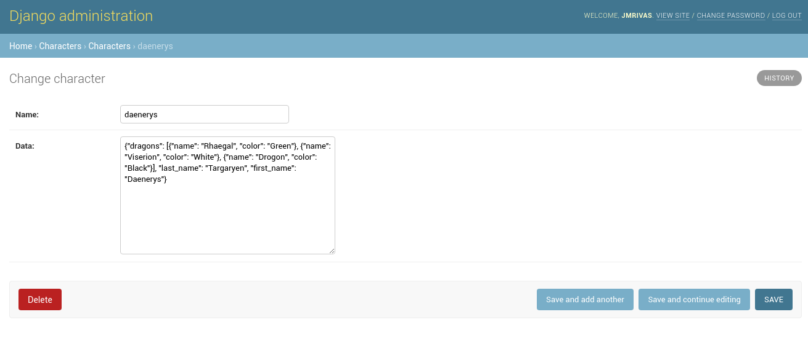
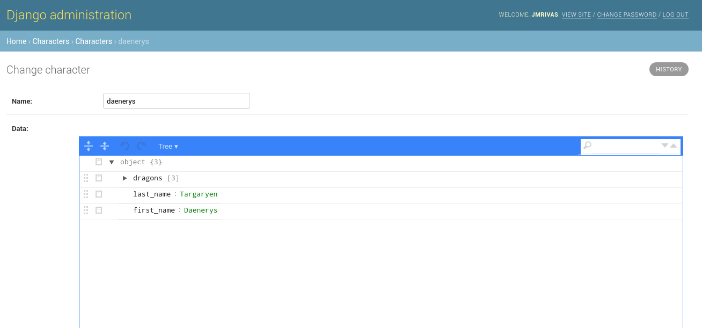

=============================
django-json-widget
=============================

.. image:: https://badge.fury.io/py/django-json-widget.svg
    :target: https://badge.fury.io/py/django-json-widget

An alternative widget that makes it easy to edit the new Django's field JSONField (PostgreSQL specific model fields)

Quickstart
----------

Install django-json-widget::

    pip install django-json-widget

Add it to your `INSTALLED_APPS`:

.. code-block:: python

    INSTALLED_APPS = (
        ...
        'django_json_widget',
        ...
    )

Add the widget in your admin.py:

.. code-block:: python

    from django.contrib import admin
    from django.db.models import JSONField
    from django_json_widget.widgets import JSONEditorWidget
    from .models import YourModel

    @admin.register(YourModel)
    class YourModelAdmin(admin.ModelAdmin):
        formfield_overrides = {
            JSONField: {'widget': JSONEditorWidget},
        }

You can also add the widget in your forms.py:

.. code-block:: python

    from django import forms
    from django_json_widget.widgets import JSONEditorWidget
    from .models import YourModel

    class YourForm(forms.ModelForm):
        class Meta:
            model = YourModel

            fields = ('jsonfield',)

            widgets = {
                'jsonfield': JSONEditorWidget
            }

Configuration
-------------

You can customize the JSONEditorWidget with the following options:

* **width**: Width of the editor as a string with CSS size units (px, em, % etc). Defaults to ``90%``.
* **height**: Height of the editor as a string CSS size units. Defaults to ``550px``.
* **options**: A dict of options accepted by the `JSON editor`_. Options that require functions (eg. onError) are not supported.
* **mode (deprecated)**: The default editor mode. This argument is redundant because it can be specified as a part of ``options``.  Preserved for backwards compatibility with version 0.2.0.
* **attrs**: HTML attributes to be applied to the wrapper element. See the `Django Widget documentation`_.

Content Security Policy
-----------------------

The widget loads its executable initialization code from a static JavaScript
file. Its initial value is embedded in a non-executable ``application/json``
script element. However, the bundled JSONEditor and its Ace code editor are
not fully compatible with a strict Content Security Policy (CSP):

* The widget and editor use inline styles, and Ace injects style elements.
  A policy that disallows inline styles can prevent the editor from displaying
  correctly.
* The default ``code`` mode creates a ``blob:`` worker. A restrictive
  ``worker-src`` can block it.
* JSON schema validation compiles schemas using JavaScript's ``Function``
  constructor. A ``script-src`` that disallows ``'unsafe-eval'`` blocks this.

Consequently, allowing only ``'self'`` for scripts and styles is not sufficient
for all widget features. The CSP directives and relaxations needed depend on
the chosen editor modes and options; test the actual configuration with CSP
enforcement before deploying. Allowing inline styles, ``blob:`` workers, or
``'unsafe-eval'`` weakens a policy, so projects that cannot accept those
exceptions should use a different editor or provide compatible assets via
``JSON_EDITOR_JS`` and ``JSON_EDITOR_CSS``.

Accessing JsonEditor Instance
-----------------------------

The JsonEditor instance is automatically exposed for external access through two methods:

1. **Window object**: Available as ``window['FIELD_ID_editor']`` where FIELD_ID is the field's HTML ID
2. **DOM element**: Available as ``container.jsonEditor`` property on the widget's container element

Example usage for external JavaScript access:

.. code-block:: javascript

    // Access via window object
    var editor = window['id_jsonfield_editor'];
    editor.set({'key': 'new value'});
    
    // Access via DOM element
    var container = document.getElementById('id_jsonfield');
    var editor = container.jsonEditor;
    editor.set({'key': 'new value'});

This allows you to programmatically call JsonEditor methods like ``set()``, ``get()``, ``update()``, etc. from custom JavaScript code running in your admin pages or forms.

.. _json editor: https://github.com/josdejong/jsoneditor/blob/master/docs/api.md#configuration-options
.. _Django Widget documentation: https://docs.djangoproject.com/en/2.1/ref/forms/widgets/#django.forms.Widget.attrs

JSONEditorWidget widget
-----------------------

Before:

After:

Development Guide
-----------------

Read the contribution guide.

Credits
-------

Tools used in rendering this package:

*  Cookiecutter_
*  `cookiecutter-djangopackage`_

.. _Cookiecutter: https://github.com/audreyr/cookiecutter
.. _`cookiecutter-djangopackage`: https://github.com/pydanny/cookiecutter-djangopackage
